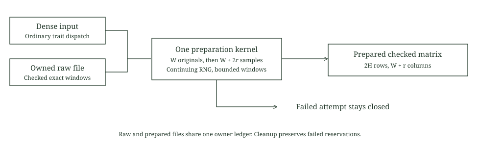

# Owned source preparation

This laboratory prepares the retained masked field layout from either a dense input or an owned checked file. Both paths use the same preparation kernel. The owned path reads exact windows and never constructs the complete raw dense matrix.

The ordinary MatrixStore randomization method delegates to that kernel. Commitment and DFT hooks explicitly refuse before a dense fallback can run. Complete denotes a finished preparation, not a completed commitment or proof. No PCS entry, opening proof, STARK, signature proof or payment integration is implemented here.



## Exact layout

For each raw row of width W, the kernel writes W original fields followed by W+2r actual sampled fields. The flat sequence is then viewed at width W+r, producing 2H rows:

$$
\text{raw}_i\;\Vert\;\text{random}_i^{W+2r},\qquad
(H,W)\longrightarrow(2H,W+r).
$$

Sampling uses the caller's continuing generator and the retained field distribution, including rejection sampling. Rows and windows retain their order. Generators are not cloned or reset. A sample passed into a failed write has already advanced the generator.

The checked file reader validates canonical fields and exact file length. Missing or short windows abort preparation. Data is never replaced by fabricated fields. Dense inputs require an exact length multiple before their height is used. Domain height and the supported natural shift are checked before output creation or sampling.

| Synthetic case | Raw bytes | Prepared bytes | Owned field files | Field samples |
| --- | ---: | ---: | ---: | ---: |
| H256, W2, r4 | 2048 | 12288 | 2 | 2560 |
| H16, W5, r4 | 320 | 1152 | 2 | 208 |

These are preparation fixtures, not selected proof profiles. The kernel does not establish the hiding budget or any security level. Later commitment integration must call the actual masking and profile preflight before entropy consumption.

## Ownership and failure

Raw input, prepared input and commitment roles are distinct. Every owned raw and output reservation counts toward the unchanged sixteen file and 2 MiB field class. Stored height remains bounded by 4096, stored width by 12, raw width by 8 and random columns by 4.

The shared owner records Ready, Preparing, Complete and Failed. A pending output is reserved before creation. Writing happens outside the owner state mutex so the same owner's raw reader can acquire its metadata lock. Successful creation is tracked independently of ledger updates. A normal error or unwind closes the output and leaves the attempt Failed across all policy clones.

Cleanup acts only on recorded owned artifacts. Removed and uncreated entries are never revisited, so a caller's replacement at a completed cleanup path survives final owner destruction. Removal failure records an orphan and retains its reservation. Explicit cleanup does not reopen the failed owner or release its conservative reservations for reuse. Preexisting unowned files are preserved.

The descriptor is dropped before the final directory lease. Prepared views therefore outlive the public policy handle. Source reader poison, owner mutex poison, explicit failure and eventual private proof opening consumption are separate states.

Drop cleanup is best effort. Durable crash recovery is not implemented. Active directory names and file contents are not authenticated against external replacement or modification. The checked descriptor prevents path replacement from redirecting an already open reader, but it does not establish immutable bytes or hardened secret storage. Only public synthetic data is used.

## Executed controls

Eight test groups pass under installed and verified 512 MiB process and aggregate limits, a fresh 2 GiB available memory admission and a 120 second deadline. They cover:

1. All prepared fields and continuing RNG state against the retained DenseStore, including a full and partial input window.
2. Early shape, exact dense length, domain and owner refusals without sampling or output creation.
3. Actual noncanonical and truncated source files.
4. Injected missing, short and poisoned reader results.
5. Partial write failure, exact entropy advancement and refusal through policy clones.
6. Injected cleanup refusal, orphan accounting and preservation of unowned and replacement files.
7. Actual owner mutex poison and a writer unwind through pending artifact cleanup.
8. Explicit refusal of unimplemented hooks and whole matrix materialization.

The source review repaired cleanup revisiting removed paths and dense height truncating trailing fields. Both have direct controls. Intentional caught panics exercise unwind and infallible trait abort boundaries. They are not cryptographic proof rejections. The measured process creates no commitment, proof, wide symbolic relation or native signature trace.

## Reproduction

```text
cargo fetch --manifest-path research/source-preparation/Cargo.toml --locked
python research/source-preparation/static_check.py
python research/source-preparation/reference.py
cargo fmt --manifest-path research/source-preparation/Cargo.toml --all -- --check
cargo test --manifest-path research/source-preparation/Cargo.toml --release --locked --offline --lib -- --test-threads=1
cargo clippy --manifest-path research/source-preparation/Cargo.toml --release --lib --tests --locked --offline -- -D warnings
```

The retained backend, preflight adapter and earlier proof records remain unchanged. A later owned PCS entry needs its own source and opening comparison. The retained top prover still accepts an owned dense raw matrix. Same witness ownership, hidden membership, stable nullifiers, conservation, encrypted delivery and ledger consumption remain separate obligations.
