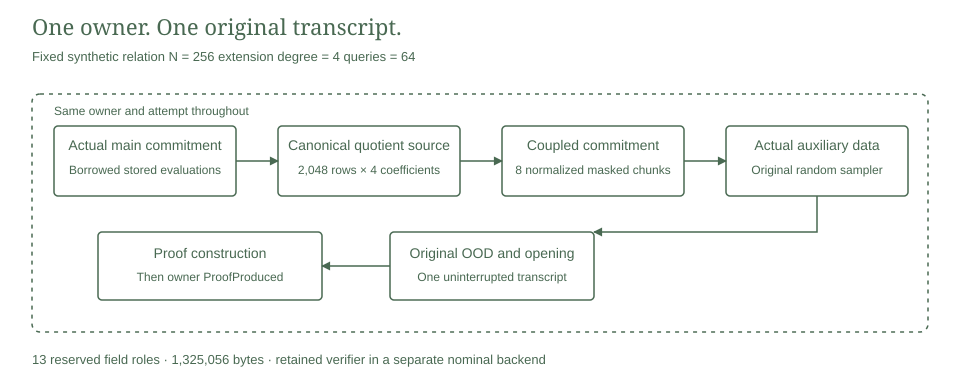

# Uninterrupted source prover

This laboratory integrates committed main data, streamed quotient construction and coupled quotient commitments into one complete small relation proof. The original transcript continues through auxiliary commitment, out of domain evaluation and the original batched opening. The resulting proof is accepted by the retained verifier under its independently compiled backend type.

The relation is the fixed public synthetic quartic experiment. It is separate from complete private signature verification, hidden note ownership and the private payment ledger.

<picture>
  <source media="(prefers-color-scheme: dark)" srcset="transcript-dark.svg">
  
</picture>

## Construction

The main commitment supplies a borrowed logical view of its actual stored evaluations. Owner, domain and private opening state are checked before access. The original constraint transcript derives the challenge $\alpha$ from the real main commitment and public values.

$$
Q(x)=Z_H(x)^{-1}\sum_j\alpha^j C_j(T(x),T(\omega x),u).
$$

Here $T$ is the committed trace, $u$ is the public input and $C_j$ are the retained AIR constraints in their original ordering. The serial kernel writes four canonical base field coefficients per extension evaluation. The same owner seals exactly 2,048 rows. There is no returned whole quotient vector or caller supplied root, challenge or witness verdict.

The consuming commitment route distributes logical row $8r+i$ into chunk $i$. Its normalized cosets and coupled masks retain the relation

$$
Z_j(x)=(x/a_j)^{256}-1,\qquad
c_i=\left(\prod_{j\ne i}Z_j(a_i)\right)^{-1},\qquad
\sum_{i=0}^{7}c_i t_{i,k}=0.
$$

The [independent integer normalization experiment](../mask-normalization/README.md) records the arithmetic comparison and its limits. The actual adapter retains the original mask sampling order, normalization and per chunk transforms. Original random auxiliary data is then committed under the same attempt. The original transcript derives the out of domain point and delegates one complete opening argument without restarting its state.

The actual Proof object is constructed before the owner enters ProofProduced. That state closes private stored reads and refuses another proving attempt. Normal errors abort the live transcript and record the original typed cause while the attempt is still alive. The kernel aborts its canonical writer before returning a generation error. Private opening authority remains the original clone shared flag in the retained backend.

## Verified scope

One guarded release test passed on 31 October 2026 with Rust 1.94.1 on an Intel Core i9-13900H running Windows x86_64.

| Observation | Recorded result |
|---|---:|
| Actual complete source proofs | 1 |
| Original verifier acceptance | 1 |
| Original verifier rejection cases | 10 |
| Main, quotient and auxiliary MMCS commitments | 3 |
| FRI MMCS commitments | 9 |
| Input and FRI batched openings | 3 and 9 |
| Queries per opening | 64 |
| Reserved field files | 13 |
| Reserved field bytes | 1,325,056 |
| Serialized proof bytes | 596,650 |
| Peak process commit | 8,085,504 bytes |
| Peak aggregate job commit | 9,379,840 bytes |

The verifier accepts the canonical decoded proof. It rejects separate changes to the two public values, main commitment, quotient commitment, auxiliary commitment, main opened value, quotient opened value, auxiliary opened value, degree bits and initial transcript context. Every serialized mutation decodes into a well formed original proof before verification. Rejections reuse the one produced proof and create no additional prover calls.

The positive verifier performs twelve batched MMCS verifications. Verification has no observed commitment, opening, private RNG or wrapped DFT effects. A second entry into the completed proving context fails without another protocol operation.

An initial diagnostic assigned eight inverse transforms to the ordinary IDFT counter. The retained masked kernel uses coset IDFT. The diagnostic failed before verification. The corrected source requires exactly zero ordinary and eight coset inverse calls, with all other controls retained. The earlier failure and distinct executable identities remain in the [validation record](validation.json).

## Resources and evidence

The external guard installed 512 MiB process and aggregate job ceilings, required at least 2 GiB free physical memory and imposed a 120 second deadline. The successful test reported 0.61 seconds through the test harness. This single observation is a diagnostic duration, not a throughput benchmark or general prover bound.

The owner retains the existing sixteen file and 2 MiB field storage class. The proof transport has a separate 2 MiB bound and the report a 16 KiB bound. Original whole domain selectors, bounded dense per chunk intermediates and FRI data remain explicit.

The DFT wrapper observes three coset extension entries, eight coset inverse entries and eight forward entries. The retained FRI final polynomial uses its own inverse transform outside this wrapper. These counters are not a count of every transform or field operation. RNG fingerprints cover delivered bytes from directly observed streams. Seeded forks have separate journals, so the fingerprints are not a complete entropy transcript.

The [source manifest](provenance.json), [original notices](NOTICE.md), [saved measurement](results/measurement.json) and [validation record](validation.json) bind the source, exact executable, resource guard and artifact identities. The synthetic proof remains a local ignored artifact. Stored result validation checks its recorded identity without regenerating it.

## Build and reproduce

The default library excludes the experiment. Saved evidence validation and compilation do not regenerate proofs.

```sh
python -I -S research/source-prover/static_check.py --check-results
cargo clippy --manifest-path research/source-prover/Cargo.toml --release --lib --locked --offline -- -D warnings
cargo clippy --manifest-path research/source-prover/Cargo.toml --release --features diagnostics --lib --test complete --locked --offline -- -D warnings
cargo test --manifest-path research/source-prover/Cargo.toml --release --features diagnostics --test complete --locked --offline --no-run --jobs 1
```

A fresh execution uses the compiled test through [the unchanged Windows guard](run_guarded_windows.ps1), one test thread and the exact test name `uninterrupted_source_proof_and_retained_rejections`. Output files are exclusive and cannot overwrite an earlier result. Source, executable, selected effects and fresh resource admission precede execution. CI checks the saved records, formatting, strict lints and compilation without replaying the native proof.

## Remaining integration

This result establishes one complete small source proof and finite original verifier controls. It is not a full signature proof, an independent hiding or soundness argument, a quantum security theorem or a private payment network. The complete signature profile remains refused by its raw width resource gate. Live transcript error injection, opening consumption controls, full proof security composition and the same witness ledger joins retain separate milestones.
