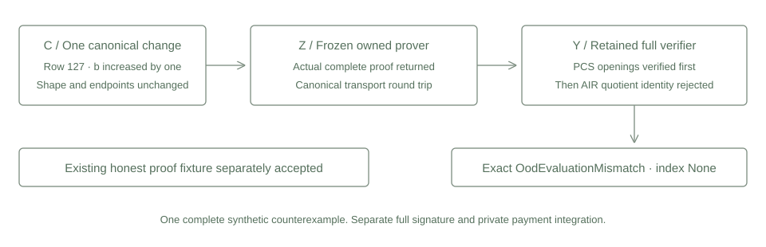

# Complete invalid witness rejection

This control sends one canonical invalid witness through the frozen owned computation prover and requires rejection by the actual retained full verifier. The backend must first return a complete proof. Constructor, parser, opening and resource errors are experiment failures, independently of the intended constraint rejection.



## One fixed violation

The original public synthetic relation has 256 rows with

$$b_i=a_i^4\quad(0\leq i<256),\qquad a_{i+1}=a_i+1\quad(0\leq i<255).$$

Its public endpoints remain 5 and 260. On zero based row 127, the original value is

$$a_{127}=132,\qquad b_{127}=132^4=303595776.$$

Only flattened field 255 changes to 303595777. Both values are canonical under modulus 2013265921. Every a value, all other b values, the vector length, AIR, configuration and public context remain unchanged. Thus this one row violates the power relation by one field unit.

## Executed verification path

The actual owned prover returned a complete proof and recorded ProofProduced. Its 600978 encoded bytes parsed into the original retained proof type and serialized identically. The retained full verifier completed PCS opening verification, then rejected the AIR quotient identity with exactly

```text
OodEvaluationMismatch { index: None }
```

The test matches the concrete Rust enum variant. It saves the observed result before interpreting it. An error string, external Boolean or native witness check does not supply the rejection verdict. ProofProduced denotes construction and remains separate from verifier acceptance.

The already published honest proof fixture was verified once and accepted. No fresh positive proof was generated. The test includes the frozen common observer without including the consumed positive test target. All prior prover and verifier sources remain unchanged.

| Measured item | Result |
| --- | ---: |
| Selected test groups | 1 |
| New complete invalid witness proofs | 1 |
| Fresh positive proofs | 0 |
| Exact retained constraint rejections | 1 |
| Existing honest fixture accepts | 1 |
| Input and FRI commitments | 3 and 9 |
| Input and FRI multi opening calls | 3 and 9 |
| Scalar opening calls | 0 |
| Encoded proof bytes | 600978 |
| Captured leaf digest bytes | 1048064 |
| Peak aggregate private memory | 23691264 bytes |
| Selected serial group duration | 0.57 seconds |

The external Windows guard installed and read back 512 MiB process and aggregate ceilings, required 2 GiB available memory and enforced a 120 second deadline. The proof cap remains 2 MiB. Field reservations remain twelve files and 1292288 bytes within the unchanged 16 file, 2 MiB field and 4096 by 12 limits. Capture and proof buffers remain part of measured process memory. Exact hardware, source and executable identities are in validation.json and provenance.json.

## Independent record checks

Independent integer arithmetic checks the original trace and exactly one changed canonical field. A separate record check reconstructs twelve Merkle roots from actual salted leaf digests and binds them to the returned complete proof. The retained pure tree and bounded reader functions are reused without invoking the old reference main routine.

The reference checks do not reconstruct leaf preimages or replace full verification. This single adversarial result is evidence for the fixed synthetic relation. Full signature constraints, private ownership and note membership, stable nullifier ledger state, conservation, private payments and quantum or knowledge security composition retain their own requirements. No production security profile is selected here.

## Reproduction

```text
cargo fetch --manifest-path research/source-stark-false/Cargo.toml --locked
python research/source-stark-false/static_check.py
python research/source-stark-false/reference.py
cargo test --manifest-path research/source-stark-false/Cargo.toml --release --locked --offline --test false_witness --jobs 1 -- --test-threads=1
python research/source-stark-false/reference.py --check-results
cargo clippy --manifest-path research/source-stark-false/Cargo.toml --release --lib --test false_witness --locked --offline -- -D warnings
```

The Windows runner requires fresh output names and a new receipt. It preserves partial witness, proof and observed verification records when an attempt fails. No positive prover or large signature prover is selected by these commands.
