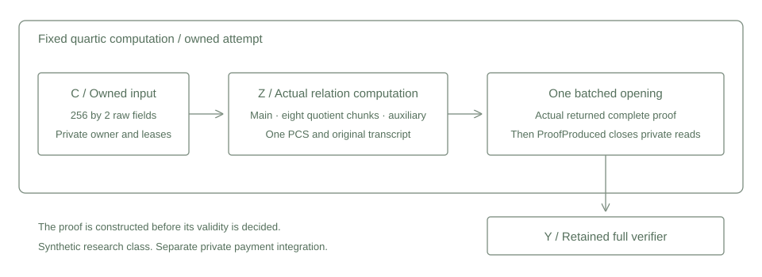

# Owned computation proof

A fixed computation proof consumes the owned main input, derives the actual constraint quotient and opens all commitments in one retained proof. Its private context holds the configuration and file owner without a clone, reset or success setter. Main commitments retain the streamed construction. Quotient and auxiliary intermediates remain bounded dense matrices before canonical file storage.



## Fixed relation

The synthetic trace contains 256 rows over the base field with modulus 2013265921. The power relation applies to every row, and the transition applies to consecutive pairs:

$$b_i=a_i^4\quad(0\leq i<256),\qquad a_{i+1}=a_i+1\quad(0\leq i<255).$$

$$a_0=5,\qquad a_{255}=260.$$

The trusted fixed AIR enforces the power relation, transitions and public endpoints. The owned constructor checks canonical shape and ownership. It does not reject a witness by evaluating its AIR in a host callback. Quotient evaluations come from the actual committed main view and retained quotient evaluator.

Logical raw height is 256. Hiding preparation extends the main domain to 512, so the original complete proof records degree_bits 9. The class uses extension degree four, four random columns, 64 queries, blowup eight, eight quotient chunks and binary FRI folding. All FRI, OOD and lookup grinding settings are zero in this research class.

## Protocol connection

1. Validate the actual target profile and create the checked owner before writing raw input.
2. Commit the actual owned main LDE through the retained hiding MMCS and private prover data constructor.
3. Bind the main root and public endpoints in the original constraint transcript, then derive quotient evaluations.
4. Commit eight coupled quotient chunks and the original auxiliary randomization polynomial through the same PCS and stored matrix family.
5. Bind their roots, sample the OOD point and derive its translated next point using the raw trace domain.
6. Run one actual batched opening in the original auxiliary, main and quotient order. Finish the transcript and construct the original complete proof.
7. Record ProofProduced and close private matrix reads. Public verification independently evaluates the actual proof and AIR.

ProofProduced records construction, independently of whether the witness satisfies the AIR. Result errors and unwinds close an unfinished attempt across clones. Reservations and existing file leases remain intact. No private flag substitutes for verifier acceptance.

The [source adaptation](adaptation.patch) records the derived protocol body, composite lifecycle and profile visibility changes. New context and private trait sources are retained separately. The original quotient arithmetic, transcript, proof format and verifier remain unchanged.

## Executed scope

Two serial test groups passed. One owned proof and one fresh retained ordinary proof produced identical complete bytes. Both were accepted by the actual retained full verifier. The test parsed owned bytes into the original retained proof type and required a canonical serialization round trip.

| Measured item | Result |
| --- | ---: |
| Complete proofs | 2 |
| Retained verifier accepts | 2 |
| Input MMCS commitments | 6 |
| FRI MMCS commitments | 18 |
| Input multi opening calls | 6 |
| FRI multi opening calls | 18 |
| Scalar opening calls | 0 |
| Encoded bytes per proof | 596650 |
| Captured leaf digest bytes | 1048064 |
| Peak aggregate private memory | 32796672 bytes |
| Selected serial test duration | 0.63 seconds |

The field lifetime remains twelve files and 1292288 bytes, within the unchanged 16 file, 2 MiB field and 4096 by 12 limits. The external Windows guard installed and read back 512 MiB process and aggregate ceilings, required 2 GiB available memory and enforced a 120 second deadline. Hardware and exact source identities are recorded in validation.json and provenance.json. These measurements describe this fixed workload.

Independent integer arithmetic checks the original trace. Independent SHA3 reconstruction checks twelve Merkle roots from actual salted leaf digests and binds them to the complete proof record. It does not reconstruct leaf preimages or replace full verification. Wrong profile and short raw input controls generated no extra proofs or commitments.

A canonical false AIR witness and actual verifier rejection remain a separate execution gate. Complete signature constraints, hidden note membership, stable nullifier ledger state, conservation, private payments and quantum or knowledge security composition retain their own integration and review requirements. No production proof profile is selected here.

## Reproduction

```text
cargo fetch --manifest-path research/source-stark/Cargo.toml --locked
python research/source-stark/static_check.py
python research/source-stark/reference.py
cargo test --manifest-path research/source-stark/Cargo.toml --release --locked --offline --test complete --jobs 1 -- --test-threads=1
python research/source-stark/reference.py --check-results
cargo clippy --manifest-path research/source-stark/Cargo.toml --release --lib --test complete --locked --offline -- -D warnings
```

The Windows runner uses fresh output names and refuses an existing receipt. Each proof remains within the 2 MiB transport cap. No large signature prover is selected by these commands.
